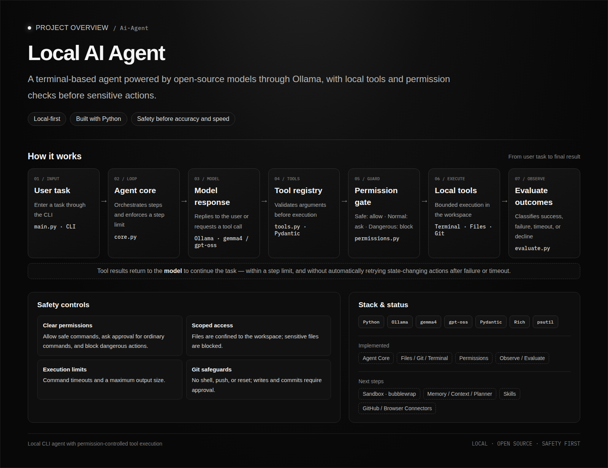

Ai-Agent

About the Project

Ai-Agent is an open-source AI agent built with Python and Ollama. It runs locally in the terminal and uses open-source large language models to understand tasks and interact with the system through tools.

The project focuses on building an agent from the ground up, with an emphasis on execution control, security, and reliability.

Core Idea

The model decides what to do, while the Python system validates tool calls, controls permissions, executes actions, and evaluates the results.

The goal is to build an agent that does more than generate responses: it can perform tasks, observe outcomes, handle failures, and operate within defined security boundaries.

Core principle: Security first, accuracy second, speed third.

Current Progress

* Local model integration through Ollama.
* Agent core and tool-calling system.
* File operations, Git tools, and terminal execution.
* Input validation and permission controls.
* Result evaluation and retry limits.

Roadmap

* Sandbox isolation using Bubblewrap.
* Context management, planning, and memory.
* Skills and external integrations.
* Improved setup, testing, and documentation.

The project is under active development.
