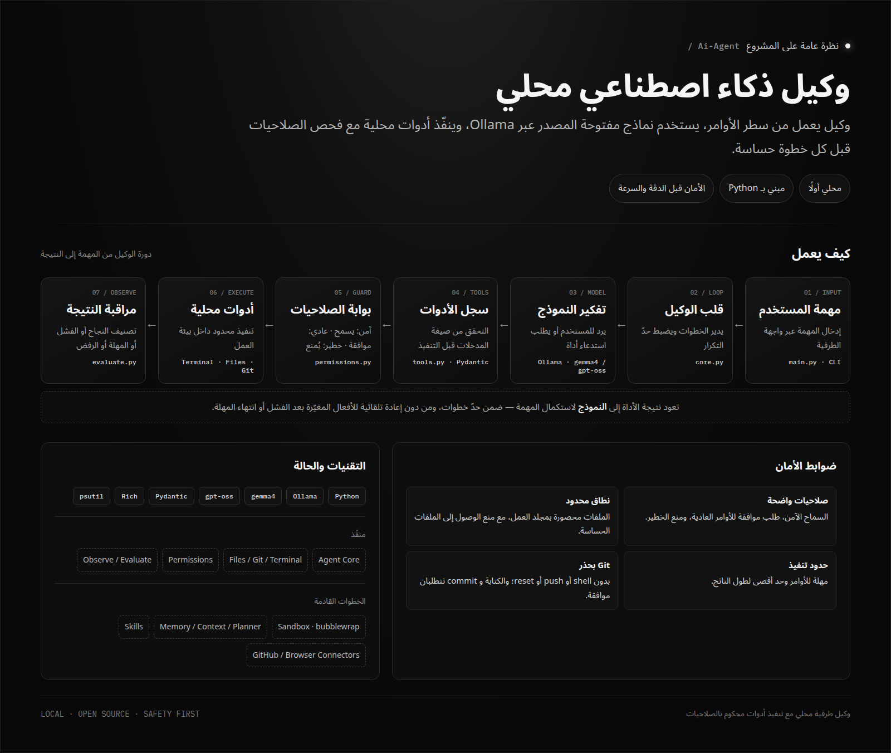
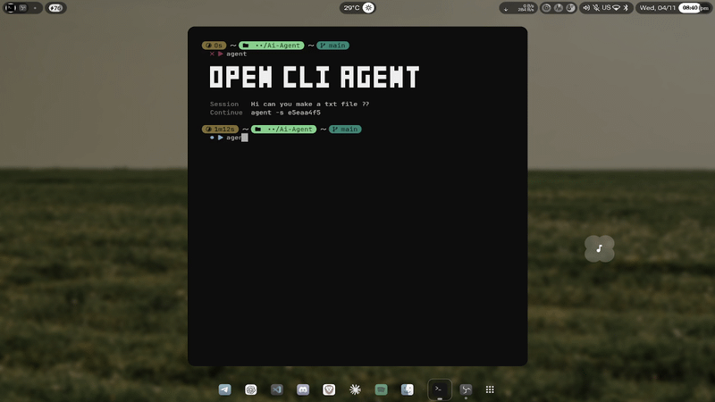

<div align="center">

# OPEN CLI AGENT

### وكيل ذكاء اصطناعي محلي يعمل من الطرفية.
**خصوصية محلية. صلاحيات واضحة. تحكّم كامل.**

<br/>

[English](README.md) · **العربية**

<br/>


<br/>

[المعاينة](#-المعاينة) · [المميزات](#-المميزات) · [التثبيت](#-البدء-السريع) · [الاستخدام](#-الاستخدام) · [الأمان](#-نموذج-الأمان) · [البنية](#-البنية) · [خارطة الطريق](#-خارطة-الطريق)

</div>

<br/>

<div dir="rtl">

> [!WARNING]
> **المشروع قيد التطوير.** قد تتغير بعض الأوامر والميزات قبل الإصدار الرسمي.

</div>

<div align="center">
  
</div>

---

<div dir="rtl">

## ✦ المعاينة

</div>

<div align="center">
  
</div>

---

<div dir="rtl">

## ✦ المميزات

واجهة طرفية متكاملة لتشغيل وكيل ذكاء اصطناعي محلي، مع أدوات فعلية ونظام صلاحيات وبيئة تنفيذ معزولة.

</div>

<table>
<tr>
<td align="center" width="33%">
<h3>⌘ واجهة طرفية</h3>
واجهة TUI تفاعلية تعرض الأدوات والسياق وحالة التنفيذ.
</td>
<td align="center" width="33%">
<h3>◈ نماذج محلية</h3>
تشغيل النماذج عبر Ollama دون الحاجة إلى مفاتيح API.
</td>
<td align="center" width="33%">
<h3>⛨ نظام صلاحيات</h3>
مراجعة الأوامر وطلب موافقتك قبل تنفيذ الإجراءات الحساسة.
</td>
</tr>
<tr>
<td align="center">
<h3>▣ بيئة معزولة</h3>
تنفيذ الأدوات داخل Sandbox باستخدام Bubblewrap.
</td>
<td align="center">
<h3>⌘ أدوات عملية</h3>
التعامل مع الطرفية والملفات ومستودعات Git.
</td>
<td align="center">
<h3>◉ ذاكرة وجلسات</h3>
حفظ الجلسات وملاحظات المشاريع واستئناف العمل.
</td>
</tr>
<tr>
<td align="center">
<h3>↔ دعم العربية</h3>
عرض النصوص العربية من اليمين إلى اليسار (RTL).
</td>
<td align="center">
<h3>⇄ إدارة السياق</h3>
تقليص السياق وإنشاء ملخص لمتابعة العمل.
</td>
<td align="center">
<h3>⚙ مستويات النماذج</h3>
اختيار نموذج يناسب إمكانيات جهازك.
</td>
</tr>
</table>

<details>
<summary><b>تفاصيل مستويات النماذج</b></summary>

| المستوى | النموذج | الاستخدام |
|---|---|---|
| خفيف | `gemma4:e2b` | الأجهزة محدودة الذاكرة |
| متوسط | `gemma4:e4b` | أغلب الأجهزة الشخصية |
| قوي | `gpt-oss:20b` | الأجهزة ذات الإمكانيات الأعلى |

يقترح معالج الإعداد الأول مستوى مناسبًا وفقًا لذاكرة الجهاز (RAM)، ويمكن تشغيله مجددًا باستخدام `--setup`.

</details>

---

<div dir="rtl">

## ✦ البدء السريع

**المتطلبات:**
- Linux
- Python 3.14
- [Ollama](https://ollama.com)
- [Bubblewrap](https://github.com/containers/bubblewrap)

### 1. تحميل المشروع

</div>

```bash
git clone https://github.com/eh7r/OPEN-CLI-AGENT.git
cd OPEN-CLI-AGENT
