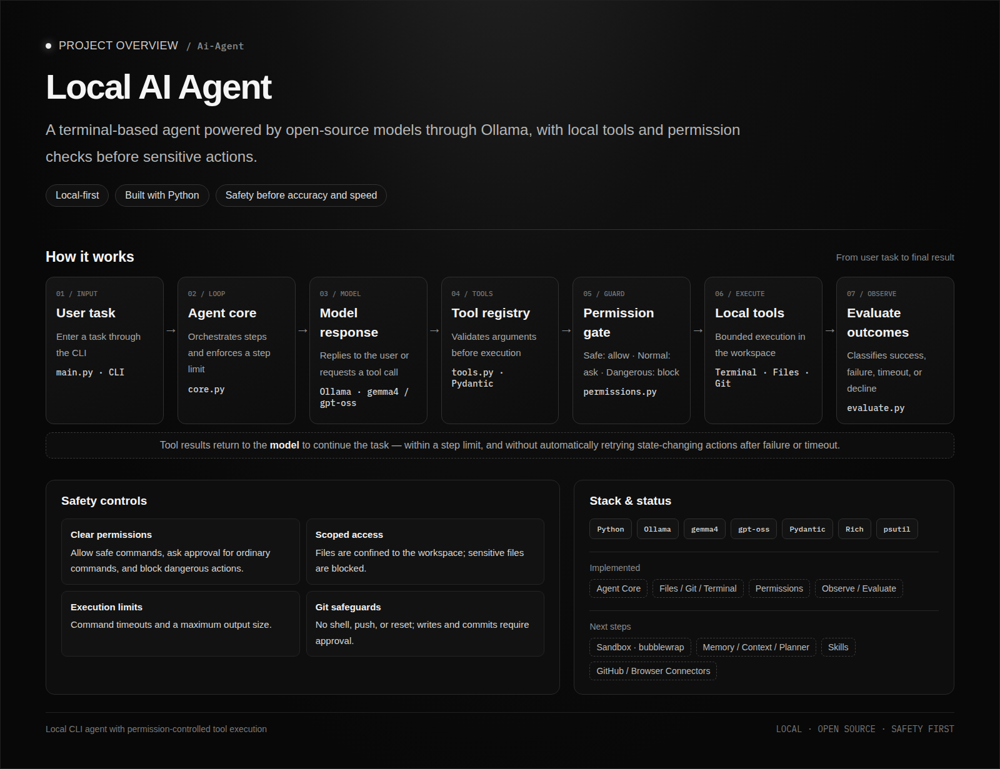
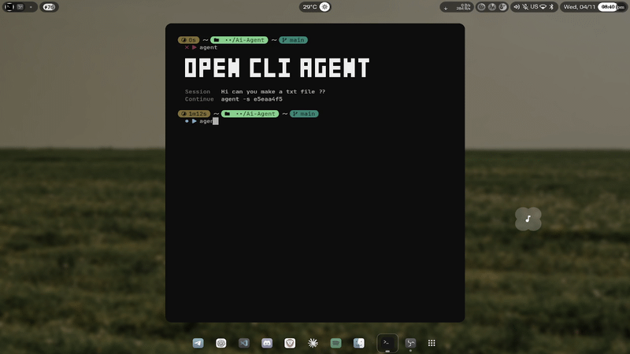

<div align="center">

# OPEN CLI AGENT

### Your local AI agent for the terminal.<br/>Private. Sandboxed. Asks before it acts.

<br/>


<br/>

[Preview](#-preview) · [Features](#-features) · [Quick Start](#-quick-start) · [Usage](#-usage) · [Security](#-security-model) · [Architecture](#-architecture) · [Roadmap](#-roadmap)

</div>

<br/>

> [!WARNING]
> **Work in Progress.** This is an active project, not an official release yet. Expect rough edges; commands and behavior may change.

<br/>

<div align="center">
  
</div>

---

## ✦ Preview

<div align="center">
  
</div>

---

## ✦ Why

Most coding agents live in the cloud and run commands on your machine with little oversight. **OPEN CLI AGENT** flips that:

- **100% local.** Models run through [Ollama](https://ollama.com). No API keys, no data leaving your device.
- **Safe by design.** Every command passes a permission layer and runs inside a sandbox.
- **Built for any hardware.** Pick a model tier that fits your device.
- **Fast first.** Prompt warm-up and cancellable requests keep it responsive.

---

## ✦ Features

| | |
|---|---|
| 🖥️ **Full-screen TUI** | Calm monochrome interface, tool blocks, context usage bar, `Esc` to interrupt |
| 🔐 **Permission layer** | Safe commands run, dangerous ones are blocked, the rest ask you first |
| 📦 **Sandbox** | bubblewrap: network closed, home hidden, `.git` read-only, environment cleared |
| 🧰 **Tools** | Terminal, file read/write (confined to the work dir), Git status/diff/commit |
| 🧠 **Notes memory** | Per-project notes, always saved with your explicit approval |
| 💾 **Saved sessions** | Resume any session with `-c` or `-s <id>` |
| 🔁 **Smart handoff** | When context fills up, get a copyable summary to continue in a fresh session |
| 🌍 **Arabic RTL** | Correct right-to-left display, including mixed English and numbers |
| ⚙️ **Three model tiers** | Light, balanced, strong: chosen per device in a first-run wizard |

<details>
<summary><b>Model tiers</b></summary>

<br/>

| Tier | Model | Best for |
|---|---|---|
| Light | `gemma4:e2b` | Low-RAM machines |
| Balanced | `gemma4:e4b` | Most laptops |
| Strong | `gpt-oss:20b` | Powerful hardware |

The first-run wizard suggests a tier by RAM. You can change it anytime with `--setup`.

</details>

---

## ✦ Quick Start

**Requirements:** Python 3, [Ollama](https://ollama.com), and [bubblewrap](https://github.com/containers/bubblewrap) (Linux).

```bash
# 1. Clone
git clone https://github.com/eh7r/OPEN-CLI-AGENT.git
cd OPEN-CLI-AGENT

# 2. Environment
python -m venv .venv
source .venv/bin/activate        # fish: source .venv/bin/activate.fish
pip install -r requirements.txt

# 3. Pull a model (pick your tier)
ollama pull gemma4:e4b

# 4. Run
python main.py
```

On first launch, a short wizard asks for your model tier and display language.

---

## ✦ Usage

```bash
python main.py              # full-screen TUI
python main.py --plain      # classic plain terminal session
python main.py -c           # continue the last session
python main.py -s <id>      # continue a specific session
python main.py --setup      # re-run the setup wizard
python main.py --notes      # list saved notes
```

### Slash commands

| Command | What it does |
|---|---|
| `/help` | Show commands and keys |
| `/new` | Start a fresh session |
| `/clear` | Clear the screen |
| `/context` | Show context usage |
| `/model` | Show model details |
| `/handoff` | Copy a continuation summary to the clipboard |
| `/exit` | Save and quit |

Press **Esc** to interrupt a running task. Context fills up? A handoff is generated automatically at 85%.

---

## ✦ Security Model

Security is the point of this project, not an add-on.

```text
Your request → Model → Tool call → Permission layer → Sandbox → Result
                                        │
                                        ├─ blocked   dangerous commands never run
                                        ├─ ask       you approve each risky action
                                        └─ allowed   known-safe commands only
```

- **Approval dialog** for every write, commit, and unknown command, showing the exact action.
- **File tools are confined** to the working directory; sensitive files (`.env`, keys) are blocked.
- **Sandbox by default**: no network, home directory hidden, `/usr` and `.git` read-only.
- **Refusal is final.** If you decline, the agent must not try another tool to get around it.
- **No blind retries** of dangerous actions; the
