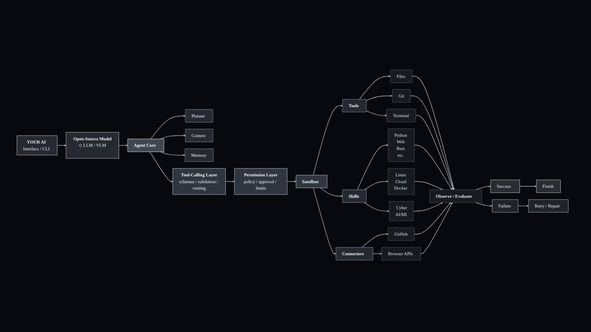

<!--
OPEN CLI AGENT — GitHub README
Media expected in docs/media/:
  hero.gif  — animated rectangular brand mark (replace this path if the filename changes)
  demo.mp4  — real terminal walkthrough (optional until recorded)
Do not describe planned capabilities as implemented features.
-->

<p align="center">
  
</p>

<p align="center">
  <a href="README.md">English</a>
  &nbsp;·&nbsp;
  <a href="README.ar.md">العربية</a>
</p>

<p align="center">
  <strong>A local-first AI agent for your terminal.</strong><br />
  Run open models locally. Give them tools. Keep execution under your control.
</p>

<p align="center">
  
  
  
  
</p>

---

## Preview

<!-- Add a real terminal recording at docs/media/demo.mp4 when it is ready. -->
<p align="center">
  <a href="docs/media/demo.mp4">▶ Watch the terminal demo</a>
</p>

> The demo recording is being prepared. The project is actively developed, and its interface and feature set may change.

## What is OPEN CLI AGENT?

OPEN CLI AGENT is a terminal-based AI agent built with Python and [Ollama](https://ollama.com). It connects locally hosted language models to a controlled set of tools so an agent can inspect files, run commands, work with Git, and evaluate the results of its actions.

The model proposes actions. The Python runtime validates tool arguments, applies permission rules, controls execution, and returns the results to the model. The aim is not simply to generate code or answers, but to make useful changes while keeping the user in control of sensitive operations.

**Local-first. Permission-aware. Still under active development.**

## Core capabilities

| Capability | What it does |
|---|---|
| Local models | Runs through Ollama; no hosted model API key is required by the agent. |
| Model selection | Recommends a model tier based on available system RAM, with manual configuration. |
| Tool calling | Uses validated tool schemas before executing an action. |
| File tools | Reads, writes, and lists files within the configured workspace. |
| Terminal | Runs shell commands through the permission and execution layers. |
| Git tools | Inspects repository status and diffs; commit actions require approval. |
| Permission controls | Separates safe, approval-required, and blocked operations. |
| Bubblewrap sandbox | Isolates shell execution by default on supported Linux systems. |
| Context management | Estimates context usage and trims older tool output when needed. |
| Persistent notes | Stores project-scoped and global notes in a local SQLite database, with user approval. |
| Saved sessions | Persists conversations locally and supports resuming a previous session. |
| Handoff | Builds a session summary from the execution journal and can add model-generated continuation tips. |
| Terminal UI | Provides an interactive Textual interface, approval prompts, status indicators, and keyboard interruption. |
| Arabic RTL | Includes terminal-aware right-to-left rendering for Arabic text. |

## How it works

<p align="center">
  
</p>

At runtime, a task moves through the agent core and model. Tool calls are validated, checked against permission rules, and executed through the available tools. Results are observed and evaluated before the agent decides what to do next.

The diagram is a high-level project architecture map. Some branches in it, including Skills and external Connectors, represent planned extension points and are **not currently shipped features**.

## Security model

Security controls are part of the execution path, not just prompt instructions.

- **Explicit permission decisions:** safe commands can run, ordinary sensitive actions require approval, and dangerous operations are blocked by policy.
- **Sandbox by default:** shell commands run through Bubblewrap (`bwrap`) when the sandbox is enabled.
- **Workspace scope:** the sandbox exposes the configured project directory for writes rather than the user's entire home directory.
- **Restricted environment:** the sandbox starts with a cleared environment, no network by default, a read-only `.git` directory, and a hidden `.env` file when present.
- **Fail closed:** if Bubblewrap is unavailable, sandboxed shell execution is refused rather than silently running outside the sandbox.
- **Bounded execution:** commands have a timeout and output limit; the agent also has a maximum step count.
- **Careful retries:** declined or blocked actions are not bypassed, and mutating actions that fail or time out are not blindly repeated.

The sandbox currently targets Linux systems with Bubblewrap and working unprivileged user namespaces. Disabling it with `AGENT_SANDBOX=off` removes this isolation and is not recommended.

## Models

The setup wizard recommends a tier based on detected system RAM. These are starting points, not guaranteed performance requirements; actual memory use depends on the model, quantization, context size, and other running applications.

| Tier | Default model | Suggested system RAM |
|---|---|---:|
| Low | `gemma4:e2b` | Under 12 GB |
| Mid | `gemma4:e4b` | 12–20 GB |
| High | `gpt-oss:20b` | 20 GB or more |

The selected model can be changed in the first-run setup or overridden with environment variables. The agent communicates with the local Ollama service at `http://localhost:11434` by default.

## Requirements

- Linux (the default Bubblewrap sandbox is Linux-specific)
- Python 3.10 or newer
- Git
- [Ollama](https://ollama.com) with a compatible model downloaded
- [Bubblewrap](https://github.com/containers/bubblewrap) for sandboxed shell execution

The Python dependencies are listed in [`requirements.txt`](requirements.txt).

## Installation

Install the system dependencies first. Package names may vary by distribution.

**Arch Linux**

```bash
sudo pacman -S --needed python python-pip git ollama bubblewrap
sudo systemctl enable --now ollama
```

**Debian / Ubuntu**

```bash
sudo apt update
sudo apt install python3 python3-venv python3-pip git bubblewrap
```

Install Ollama using the [official Linux instructions](https://ollama.com/download/linux), then start its service.

**Fedora**

```bash
sudo dnf install python3 python3-pip git bubblewrap
```

Install Ollama using the [official Linux instructions](https://ollama.com/download/linux).

Clone the repository and create a virtual environment:

```bash
git clone https://github.com/eh7r/Ai-agent.git
cd Ai-agent
python3 -m venv .venv
```

Activate it and install the Python dependencies:

```bash
# bash / zsh
source .venv/bin/activate

# fish
source .venv/bin/activate.fish

pip install -r requirements.txt
```

Download a model in Ollama. For example:

```bash
ollama pull gemma4:e4b
```

Start the agent:

```bash
python main.py
```

On the first interactive run, the setup wizard recommends a model tier and can offer to download the selected model. To start the plain terminal interface instead:

```bash
python main.py --plain
```

> Repository access and the clone URL may change while the project is being prepared for its first public release.

## Usage

Run a single task directly:

```bash
python main.py "Inspect this project and explain its structure"
```

Start an interactive session:

```bash
python main.py
```

Useful TUI commands:

| Command | Action |
|---|---|
| `/help` | Show available commands |
| `/clear` | Clear the visible chat output |
| `/new` | Start a fresh session |
| `/context` | Show estimated context usage |
| `/model` | Show the active model and detected tier |
| `/handoff` | Generate and copy a session handoff |
| `/exit` | Exit the interface |

Session options:

```bash
python main.py -c          # Continue the most recent saved session
python main.py -s <id>     # Resume a session by its ID
python main.py --setup     # Reopen model setup
python main.py --notes     # Display saved notes
```

## Configuration

Environment variables override saved setup values. `AGENT_MODEL` takes precedence over `AGENT_TIER`; otherwise the saved setup choice or automatic RAM detection is used.

| Variable | Default | Purpose |
|---|---|---|
| `AGENT_MODEL` | Selected tier model | Use an exact Ollama model name. |
| `AGENT_TIER` | Automatic | Select `low`, `mid`, or `high`. |
| `OLLAMA_HOST` | `http://localhost:11434` | Ollama server address. |
| `AGENT_MAX_STEPS` | `10` | Maximum agent steps per task. |
| `AGENT_WORKDIR` | Current directory | Workspace used by file, terminal, and Git tools. |
| `AGENT_TIMEOUT` | `30` seconds | Shell command timeout. |
| `AGENT_MAX_OUTPUT` | `4000` characters | Maximum tool output sent to the model. |
| `AGENT_CONTEXT` | `4096` tokens | Context window configured for the model. |
| `AGENT_MAX_REPLY` | `1024` tokens | Maximum generated tokens per model reply. |
| `AGENT_SANDBOX` | `on` | Set to `off` to disable Bubblewrap isolation. |
| `AGENT_SANDBOX_NET` | `0` | Set to `1` to allow network access inside the sandbox. |
| `AGENT_MEMORY_DB` | `~/.local/share/ai-agent/memory.db` | SQLite notes database path. |
| `AGENT_THINK` | `0` | Set to `1` to enable Ollama thinking mode where supported. |
| `AGENT_TRACE` | `0` | Set to `1` to write request timing diagnostics to `/tmp/agent-trace.log`. |

Example for fish:

```fish
env AGENT_MODEL=gpt-oss:20b python main.py
```

## Project status

OPEN CLI AGENT is a work in progress. The current codebase includes the core agent loop, local model integration, permission checks, the Linux sandbox, file/terminal/Git tools, context management, local notes, saved sessions, handoff generation, the interactive interface, and Arabic RTL rendering.

The architecture and roadmap may evolve. Features such as a general Skills system, external Connectors, and browser integrations are not presented as available functionality in this release.

## Development and tests

Install development dependencies and run the test suite:

```bash
pip install -r requirements-dev.txt
pytest -q
```

Contributions and issue reports will be documented when the repository is opened for public contributions. Until then, the project is being developed and validated privately.

---

<p align="center">
  <sub>OPEN CLI AGENT · LOCAL-FIRST · PERMISSION-AWARE · WORK IN PROGRESS</sub>
</p>

